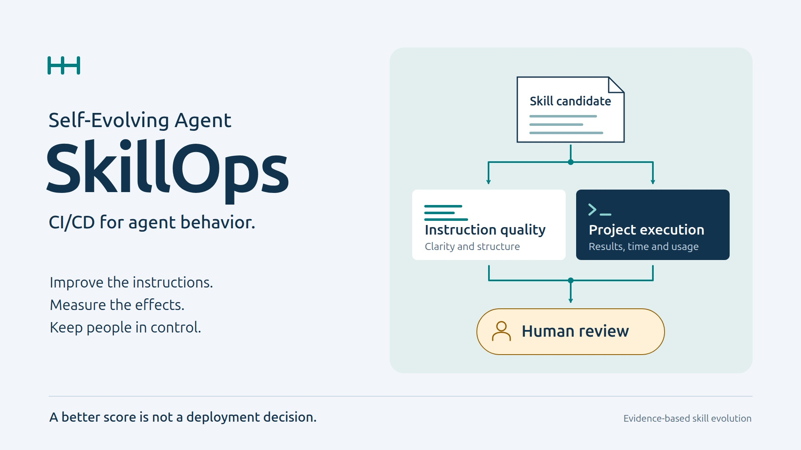

# Self-Evolving Agent SkillOps

[English](README.md) | [한국어](README.ko.md)

**에이전트 행동 지침을 위한 CI/CD. SkillOps가 제안하고, 근거를 바탕으로 사람이 승인합니다.**

Self-Evolving Agent SkillOps는 AI 에이전트로 재사용 가능한 Skill을 평가하고,
지침 수정안을 제안하며, 프로젝트에서 그 효과를 검증합니다. 한도가 있는 피드백 기반
반복 과정에서 평가 결과를 다음 후보에 반영할 수 있습니다.
진화의 대상은 모델 가중치가 아니라 지침 묶음입니다.

여기서 “자가 진화”는 에이전트가 후보를 제안하고 평가한다는 뜻입니다.
활성 Skill을 알리지 않고 덮어쓰거나 운영 환경에 자동 배포한다는 뜻이 아닙니다.
**명시적인 사람 승인 게이트가 후보 평가와 실제 채택을 분리합니다.**

## 데모 영상 — 1분 50초

[](docs/media/skillops-demo-en.mp4)

[데모 영상 보기 또는 다운로드(MP4)](docs/media/skillops-demo-en.mp4) ·
영어 내레이션·화면에 삽입된 영어 자막 · 110초

*2026년 9월 21일 촬영했습니다. 저장된 근거를 살펴보는 영상이며 새로운 평가나 승인을
실행하지 않습니다. 영상의 “GEPA 미통합” 설명은 촬영 당시 버전 기준입니다.
현재 코드는 [선택적인 GEPA 최적화](docs/GEPA.md)를 지원합니다.*

## 해결하려는 문제

더 잘 작성된 Skill이 반드시 더 좋은 결과를 만드는 것은 아닙니다.
지침 품질 점수가 올라도 생성된 코드는 같고, 기존 검사는 여전히 실패하며,
실행 시간과 자원 사용량은 오히려 늘어날 수 있습니다.

근거는 지침 변경 내역, 평가 보고서, 실행 로그에 흩어져 있는 경우가 많습니다.
팀은 무엇이 바뀌었는지, 해당 프로젝트에서 도움이 됐는지,
후보를 채택할 준비가 됐는지 명확하게 판단할 수 있어야 합니다.

## 해결 방법

SkillOps는 에이전트 기반 개선 과정에서 네 가지 활동을 연결합니다.

- **평가:** 버전이 식별되는 Skill 묶음을 탐지하고, Anthropic의 Skill 작성 가이드에서
  도출한 기준처럼 명시적인 기준으로 지침 품질을 평가합니다.
  다른 지침 품질 평가셋을 추가하는 기능은 계획 단계입니다.
- **제안:** AI 에이전트가 평가 결과와 확인 가능한 프로젝트 검사 결과를 활용해
  수정 지침, 해결하려는 지적 사항, 개선 가설을 생성합니다. 원본은 덮어쓰지 않습니다.
- **비교와 반복:** 지침 평가와 지원되는 프로젝트 검사로 후보를 원본과 비교합니다.
  선택적으로 실행하는 개발 반복 과정은 명시적인 반복 횟수·호출·시간 한도 안에서
  평가 결과를 다음 에이전트 생성 후보에 반영합니다.
- **검토와 승인:** 읽기 전용 대시보드에서 근거를 확인한 뒤, 별도의 로컬 기능으로
  최종 확인과 사람 승인을 수행합니다. 승인 게이트는 평가와 채택을 분리하며,
  이후 실행에도 별도의 권한이 필요합니다.

후보 계보, 평가 피드백, 중단 이유는 추적 가능한 상태로 보존합니다.
검사 부재와 불완전한 검증은 성공이 아니라 **미검증**으로 남깁니다.

## 제공하는 가치

Skill 작성자는 반복적인 평가와 수정을 자동화하고, 개발자는 실행 결과의 장단점을
살펴보며, 검토자는 연결된 근거를 바탕으로 채택 여부를 판단할 수 있습니다.

영상의 실제 비교 기록은 이러한 구분이 왜 필요한지 보여줍니다. 후보의 지침 품질
점수는 올랐지만 생성된 코드는 같았고, 동일한 검사 두 개가 계속 실패했으며,
시간과 기록된 사용량은 증가했습니다. 저장된 판정은 여전히 **improved**였습니다.
판정 이름만 보지 않고 그 근거를 확인해야 하는 이유입니다.
승인과 다음 작업 사용은 기록되지 않았습니다.

목표는 수동으로 근거를 모으는 수고를 줄이고 판단 과정을 투명하게 만드는 것입니다.
조직 전체의 생산성 향상을 실측했다거나, 한 번의 비교로 일반적인 성능 개선을
입증했다는 주장은 아닙니다.

## 차별점

**에이전트 기반의 제한된 자가 진화.** 에이전트는 확인 가능한 지적 사항에서 지침 후보를
생성하고, 선택적인 개발 반복 과정에서 평가 피드백을 후속 수정에 활용합니다.
원본 Skill과 각 후보의 계보는 보존합니다. 이후 운영 작업과 사용자 피드백을
자동으로 학습에 연결하는 기능은 계획 단계입니다.

**GEPA에서 영감을 받은 개선과 선택적인 GEPA 최적화.** SkillOps는 순차 반복의
선택적 대안으로 공식 [GEPA 옵티마이저](https://github.com/gepa-ai/gepa)를 통합했습니다.
실행 피드백과 검사 사례별 Pareto 기반 부모 선택으로 지침 후보를 탐색합니다.
이 통합은 품질·비용·시간을 함께 최적화하는 방식은 아닙니다.
평가, 독립 최종 확인, 사람 승인은 별도의 게이트로 유지합니다.

**평가셋 기반 평가.** 초기 지침 품질 평가 기준은 Anthropic의 Skill 작성 가이드에서
도출했습니다. 프로젝트 자체 평가이며 Anthropic의 공식 벤치마크나 인증이 아닙니다.
프로젝트별 작업 데이터셋과 별도의 후보 선택용 검증(validation) 실행 경로는 구현되어
있습니다. 다른 지침 품질 가이드나 조직별 표준을 선택하는 카탈로그는 계획 단계이며,
각 평가셋의 버전과 결과를 별도로 보존하는 방향입니다.

**명시적인 승인 게이트.** 자동 개선은 검토 가능한 후보를 만들 뿐, 배포 권한을
부여하지 않습니다. 별도의 최종 확인과 사람 승인은 개발 평가의 좋은 결과가
후보 채택이나 실행 허가로 해석되지 않도록 합니다. 이러한 통제 기능은 구현되어
있지만, 영상 속 후보가 모든 단계를 완료했다는 뜻은 아닙니다.

## 기술 기반

프로토타입은 에이전트 상호작용을 위한 **GitHub Copilot CLI**, 평가와 제한된 반복을
조율하는 **Python 도구**, **Docker 기반 프로젝트 검사**, **GitHub Actions**,
**Azure에서 호스팅하는 읽기 전용 대시보드**를 결합합니다.

버전이 식별되는 근거 파일은 원본 Skill, 에이전트가 생성한 후보, 평가 결과,
실행 비교를 연결합니다. 이 구성 요소들이 에이전트 지침의 통제된 개선 과정을
뒷받침합니다.

**SkillOps가 제안하고, 근거를 바탕으로 사람이 승인합니다.**

## 시작하기

Linux와 Python 3.12 이상이 준비된 로컬 저장소 루트에서,
인증이나 모델 호출이 필요 없는 조회 명령부터 실행합니다.

```bash
python3 -m venv .venv
. .venv/bin/activate
python3 -m pip --isolated install --disable-pip-version-check \
  --only-binary=:all: --require-hashes --index-url https://pypi.org/simple \
  -r skillops/requirements-evaluator.txt
python3 skillops/skillops.py --help
python3 skillops/project_results.py catalog
```

의존성 설치는 패키지 인덱스에 접근합니다. 실제 모델 평가에는 인증된 Copilot CLI,
Docker, 명시적으로 승인된 호출·시간·Credit 한도가 추가로 필요합니다.
화면을 보기 위해 실제 모델 평가를 켜지 말고,
[오프라인 발표 가이드](docs/OPERATIONS.ko.md#오프라인-발표-백업)를 이용하세요.
비공개 실행 데이터는 기본적으로 공개 대상이 아닙니다.

## 문서와 기여

| 필요한 내용 | 안내 |
| --- | --- |
| 명령, 승인 게이트, 과거 측정값 | [운영 가이드](docs/OPERATIONS.ko.md) |
| GEPA 설치, 점수 산정, 실행 한도 | [GEPA 통합](docs/GEPA.md) |
| 데이터셋 준비와 독립 검증 | [Project C 예제](docs/GEPA.md#project-c-dataset-preparation) · [검증 계약](docs/GEPA.md#independent-validation) |
| 프로젝트 평가, 결과 형식, 대시보드 | [프로젝트 평가](docs/PROJECT-EVALUATION.md) |
| Replay·반복·최종 확인·승인 계약 | [계약](docs/HACKATHON-CONTRACTS.md) |
| 평가 없이 검토된 기록만 게시 | [검토 결과 게시](docs/REVIEWED-PUBLICATION.md) |
| 과거 벤치마크 근거 | [평가 기록](evidence/README.ko.md) |
| 계획된 작업과 기여 | [작성 시점의 로드맵](docs/ROADMAP.md) · [기여 가이드](CONTRIBUTING.md) |

기능 브랜치와 PR로 변경을 제안하세요.
근거를 보존하고 구현된 기능, 측정한 결과, 가설과 계획을 구분합니다.
